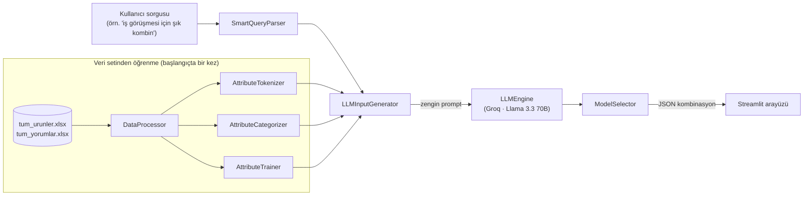

<div align="center">


# DAPHNE — Moda AI Kombin Asistanı

**Doğal dille konuş, kombinini al.** Trendyol ürün ve yorum verisini kullanarak
Groq LLM üzerinden kişiselleştirilmiş kıyafet kombini öneren bir Streamlit sohbet uygulaması.


</div>

---

## 🎯 Proje Hakkında

DAPHNE, e-ticarette alışveriş yaparken yaşanan **"karar verme felci"** problemini çözmeyi
hedefler. Geleneksel renk/beden/marka filtreleriyle arama yapmak yerine kullanıcı
"*toplantım var, şık bir kombin öner*" gibi doğal bir cümle yazar; sistem bunu anlamlandırıp
gerçek ürünlerden oluşan bir kombin önerir.

| Geleneksel e-ticaret araması | DAPHNE |
|---|---|
| Anahtar kelime + statik filtre (Renk: Mavi) | Doğal dil / semantik anlama |
| "Ara → Filtrele → İncele" (yorucu) | "Sohbet et → Öneri al → Satın al" |
| Kullanıcı niyetini anlamaz | Bağlam bazlı (durum, stil, mevsim) öneri |

Projenin problem tanımı, paydaş görüşmeleri, rakip analizi (YesPlz AI, Stitch Fix, Acloset,
Google Virtual Try-On) ve SCRUM bazlı yol haritasının tamamı
[`docs/Sistem_Analizi_ve_Tasarimi.docx`](docs/Sistem_Analizi_ve_Tasarimi.docx) dosyasında yer alıyor.

## 🧠 Nasıl Çalışıyor

Kullanıcı sorgusu, veri setinden **kurallardan değil veriden öğrenilmiş** öznitelik
bilgisiyle zenginleştirildikten sonra LLM'e gönderiliyor; LLM çıktısı da tekrar gerçek
ürün kataloğuna karşı doğrulanıyor:



| Bileşen | Dosya | Görevi |
|---|---|---|
| `DataProcessor` | `src/data_processor.py` | xlsx veri setlerini yükler, ürün/yorum context'i üretir |
| `AttributeTokenizer` | `src/attribute_tokenizer.py` | Her sütunu (fiyat, renk, kategori…) anlamlandırıp tokenize eder |
| `AttributeCategorizer` | `src/attribute_categorizer.py` | Öznitelikleri sayısal/metin/tarih/boolean kategorilerine ayırır |
| `AttributeTrainer` | `src/attribute_trainer.py` | Renk, stil ve duygu pattern'lerini **veri setinden** (seed kullanmadan) öğrenir |
| `SmartQueryParser` | `src/smart_query_parser.py` | Kullanıcı sorgusundan renk/kategori/stil/bağlam filtrelerini çıkarır |
| `LLMInputGenerator` | `src/llm_input_generator.py` | Öğrenilen pattern'lerle zenginleştirilmiş LLM prompt'u kurar |
| `LLMEngine` | `src/llm_engine.py` | Groq API üzerinden `llama-3.3-70b-versatile` modelini çağırır |
| `ModelSelector` | `src/model_selector.py` | LLM'in JSON çıktısını ayrıştırıp gerçek ürün verisiyle zenginleştirir |
| `app.py` | `app.py` | Streamlit sohbet arayüzü |

## 🛠️ Teknoloji Yığını

| Katman | Teknoloji |
|---|---|
| Arayüz | Streamlit 1.28 (sohbet arayüzü, pastel tema) |
| Dil Modeli | Groq Cloud · Llama 3.3 70B Versatile |
| Veri İşleme | pandas, openpyxl, numpy |
| Konfigürasyon | python-dotenv |
| Veri Kaynağı | Trendyol ürün kataloğu + kullanıcı yorumları (xlsx) |

## 📁 Proje Yapısı

```
ModaAi/
├── app.py                      # Streamlit giriş noktası
├── requirements.txt
├── .env                        # GROQ_API_KEY (repoya dahil değil)
├── assets/
│   └── barbie.png               # Arayüz logosu
├── data/
│   ├── tum_urunler.xlsx         # Ürün kataloğu (Git LFS)
│   └── tum_yorumlar.xlsx        # Kullanıcı yorumları (Git LFS)
├── src/
│   ├── data_processor.py
│   ├── attribute_tokenizer.py
│   ├── attribute_categorizer.py
│   ├── attribute_trainer.py
│   ├── smart_query_parser.py
│   ├── llm_input_generator.py
│   ├── llm_engine.py
│   ├── model_selector.py
│   └── recommendation_engine.py
└── docs/
    └── Sistem_Analizi_ve_Tasarimi.docx   # Sistem analizi ve tasarım raporu
```

> **Not — büyük veri dosyaları:** `data/tum_yorumlar.xlsx` ~124 MB olduğu için bu repoda
> [Git LFS](https://git-lfs.github.com/) ile takip ediliyor. Repoyu klonlarken `git lfs`
> kurulu olduğundan emin olun.

## 🚀 Kurulum ve Çalıştırma

```bash
# 1. Bağımlılıkları kur
pip install -r requirements.txt

# 2. .env dosyasını oluştur
echo "GROQ_API_KEY=senin-groq-api-anahtarin" > .env

# 3. Uygulamayı başlat
streamlit run app.py
```

Uygulama `http://localhost:8501` adresinde açılır. Sohbet kutusuna doğal dille isteğini
yazman ya da kenar çubuğundaki hazır önerilerden birini seçmen yeterli.

## 💬 Örnek Sorgular

- "Toplantım var, şık bir kombin öner"
- "Günlük kullanım için rahat bir kombin"
- "İş görüşmesi için profesyonel kombin"
- "Yaz için hafif ve şık bir kombin"
- "Kış için sıcak tutan bir kombin"

## 📄 Dokümantasyon

- [`docs/Sistem_Analizi_ve_Tasarimi.docx`](docs/Sistem_Analizi_ve_Tasarimi.docx) — problem
  tanımı, paydaş/kullanıcı görüşmeleri, rakip analizi, mimari kararlar (API-First /
  mikroservis yaklaşımı), risk yönetimi ve SCRUM yol haritası.
